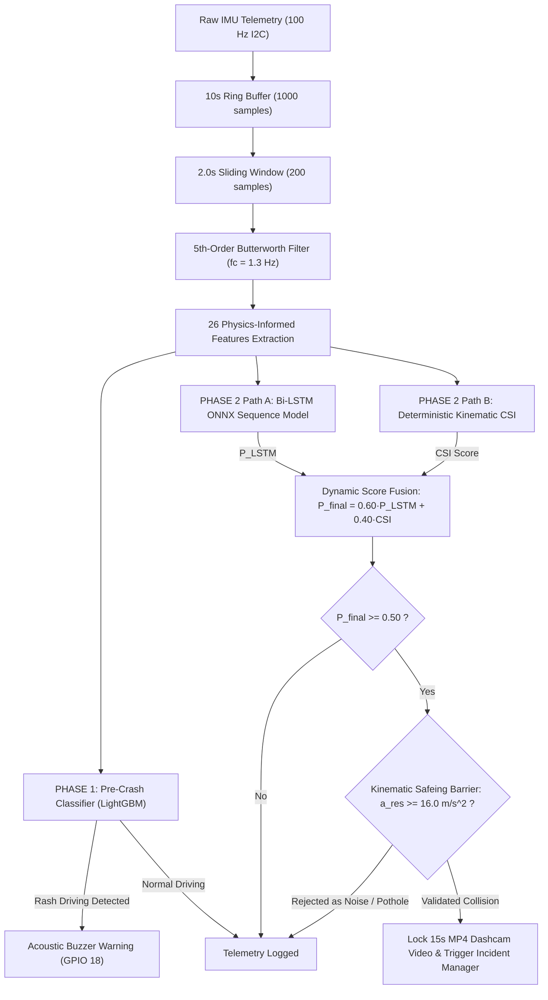

<div align="center">

# 🚗💥 IntelliCrash

**Autonomous Vehicular Pre-Crash Monitoring, Real-Time Collision Detection, and Emergency Response System**

*A cyber-physical IoT ecosystem combining dual-phase edge AI (Binary LightGBM + Bi-LSTM ONNX), deterministic physics kinematics (Crash Severity Index), closed-loop emergency verification, and spatial cloud telematics.*

---

[](https://www.python.org/)
[](https://nextjs.org/)
[](https://react.dev/)
[](https://tailwindcss.com/)
[](https://onnxruntime.ai/)
[](https://www.raspberrypi.com/)
[](https://sqlite.org/)
[](LICENSE)

<br/>

<a href="#-tech-stack">
  
</a>

</div>

---

## 📌 Table of Contents

- [Problem Statement & Golden Hour Mitigation](#-problem-statement--golden-hour-mitigation)
- [Key Innovations](#-key-innovations)
- [System Architecture](#-system-architecture)
- [Dual-Phase AI & Kinematic Safeing Pipeline](#-dual-phase-ai--kinematic-safeing-pipeline)
- [Closed-Loop Emergency Incident Protocol](#-closed-loop-emergency-incident-protocol)
- [Repository Structure](#-repository-structure)
- [Tech Stack](#-tech-stack)
- [Hardware Test Bench Specifications](#-hardware-test-bench-specifications)
- [Getting Started](#-getting-started)
  - [1. Raspberry Pi Edge Node Setup](#1-raspberry-pi-edge-node-setup)
  - [2. Next.js Spatial Web Dashboard Setup](#2-nextjs-spatial-web-dashboard-setup)
  - [3. Hardware ML Training Suite](#3-hardware-ml-training-suite)
- [Performance & Validation Results](#-performance--validation-results)
- [License & Academic Credits](#-license--academic-credits)

---

## 🚨 Problem Statement & Golden Hour Mitigation

Vehicular collision fatalities are disproportionately severe due to emergency response delays. The **Golden Hour** — the first 60 minutes following a severe crash — is decisive for medical intervention and survival. Conventional crash detection mechanisms suffer from critical operational limitations:

1. **High False-Alarm Rates:** Sudden speed bumps, potholes, or heavy braking routinely misclassify as collisions.
2. **Cellular Vulnerability:** Pure cloud-dependent architectures fail completely in dead zones and cellular blackouts.
3. **No Closed-Loop Driver Verification:** Automated systems blindly dispatch emergency services for minor scrapes or non-critical incidents, overburdening municipal trauma services.
4. **Lack of Forensic Attribution:** First responders and fleet operators lack immediate objective data on collision severity, impact g-force, or pre-crash driver behavior.

**IntelliCrash** resolves these bottlenecks via a **hybrid cyber-physical architecture** executed on bare-metal ARM64 hardware, delivering deterministic sub-second crash validation, closed-loop driver verification, multi-channel alerting, and spatial GIS incident telemetry.

---

## ✨ Key Innovations

| Capability | Technical Realization |
|---|---|
| **Dual-Phase Edge Inference** | Concurrently executes **Phase-1 Pre-Crash Rash Driving Classification** (Binary LightGBM) and **Phase-2 Crash Impact Sequence Inference** (Deep Bi-LSTM ONNX). |
| **Physics-Informed Fusion Gate** | Dynamic score fusion ($P_{\text{final}} = 0.60 \cdot P_{\text{LSTM}} + 0.40 \cdot \text{CSI}$) cross-validated against a physical kinematic safeing barrier ($a_{\text{res}} \ge 16.0\text{ m/s}^2$). |
| **Kinematic Feature Engineering** | Extracts 26 physics-informed kinematics and spectral features (Delta-V, RMS Jerk, Spectral Energy, FFT Centroid) from 100 Hz 5th-order Butterworth-filtered IMU telemetry. |
| **Closed-Loop Safety Verification** | Dispatches an interactive 60-second Telegram verification countdown to the driver (`"I'm OK"` / `"I need help"`), eliminating false emergency dispatches. |
| **Autonomous Trauma Center Radar** | Haversine distance ranking against a local trauma registry (`hospitals.json`) with automated one-time token link dispatch (`/api/ack`) and ambulance ETA tracking. |
| **Store-and-Forward Resilience** | Local SQLite WAL-mode queue (`is_synced = 0`) and SD card `blackbox_queue/` buffer data locally during cellular outages and auto-sync on link recovery. |
| **Forensic Video Buffer** | Sony IMX708 MIPI CSI-2 camera locks a circular 15-second rolling MP4 video container (10s pre-crash + 5s post-crash) as immutable legal evidence. |
| **Explainable AI (XAI) Forensics** | TreeSHAP waterfall and summary plots explain exact physical feature attributions for every detected incident. |

---

## 🏛️ System Architecture

IntelliCrash is architected across five cohesive cyber-physical layers:

```
+---------------------------------------------------------------------------------------------------+
|                                 INTELLICRASH 5-LAYER ARCHITECTURE                                 |
+---------------------------------------------------------------------------------------------------+
|                                                                                                   |
|  [LAYER 5: PRESENTATION, AUTHENTICATION & SPATIAL DASHBOARD LAYER]                                |
|  - Role-Based Access Control (RBAC): Fleet Owner, Emergency Responder, System Architect (Admin)   |
|  - Next.js 16 Web Portal (React 19, Tailwind CSS 4, Three.js 3D Attitude Playback)                |
|  - Interactive Leaflet GIS Fleet Mapping, Crash Heatmaps & Recharts Kinematic Curves              |
|  - One-Click Trauma Center Acknowledgment & Ambulance ETA Portal (/api/ack)                       |
|                                                                                                   |
|  [LAYER 4: RESILIENT TELEMATICS & COMMUNICATIONS LAYER]                                          |
|  - Autonomous Multi-Channel Dispatcher: Twilio SMS, Synthesized Voice Calls, Telegram GPS Pins   |
|  - SMTP TLS Emergency Trauma Dossier Dispatcher with Synchronized Video Evidence                  |
|  - 20 Hz Real-Time WebSocket Telemetry Stream (ws://0.0.0.0:8765)                                 |
|  - Embedded SQLite3 Store-and-Forward Replay Sync (POST /api/ingest)                              |
|                                                                                                   |
|  [LAYER 3: EDGE AI & HYBRID FUSION INFERENCE LAYER]                                               |
|  - ONNX Runtime Execution Provider (ARM64 Optimized, <15 ms latency)                             |
|  - Phase 1: Binary LightGBM Classifier (Normal vs. Rash Driving Maneuver)                        |
|  - Phase 2 Path A: Deep Bidirectional LSTM (Bi-LSTM) Sequence Model                              |
|  - Phase 2 Path B: Deterministic Kinematic Crash Severity Index (CSI) Formulator                  |
|  - Physical Safeing Barrier Gate (Resultant a_res >= 16.0 m/s^2)                                  |
|                                                                                                   |
|  [LAYER 2: SIGNAL PREPROCESSING & FEATURE EXTRACTION LAYER]                                       |
|  - Circular Sensor Ring Buffer (1000 samples @ 100 Hz / 10s continuous memory)                    |
|  - 5th-Order Butterworth Low-Pass Filter (Cutoff frequency fc = 1.3 Hz)                           |
|  - Vectorized Feature Engineering Engine (26 Temporal, Kinematic & Spectral Metrics)              |
|                                                                                                   |
|  [LAYER 1: PHYSICAL HARDWARE & TRANSDUCER LAYER]                                                  |
|  - Processing Host: Raspberry Pi 4 Model B (4GB LPDDR4, Quad Cortex-A72 @ 1.5 GHz)                |
|  - 6DoF Inertial Sensor: SmartElex ISM330DHCX (I2C-1 Bus @ 400 kHz, Address 0x6B)                |
|  - Multi-Constellation GNSS: u-blox NEO-8M (UART Serial Bus @ 9600 Baud)                         |
|  - Optical Sensor: Raspberry Pi Camera Module 3 (Sony IMX708, MIPI CSI-2 Bus)                     |
|  - In-Cabin Acoustic Actuator: Active Piezo Buzzer (GPIO 18 PWM Resonant Driver)                 |
|                                                                                                   |
+---------------------------------------------------------------------------------------------------+
```

---

## ⚡ Dual-Phase AI & Kinematic Safeing Pipeline



---

## 🚑 Closed-Loop Emergency Incident Protocol

When a collision clears the kinematic safeing barrier:

1. **Driver Safety Verification:** An interactive Telegram prompt with `"I'm OK"` and `"I need help"` callback buttons is dispatched to the driver alongside an audible alert. A 60-second verification countdown initiates.
   - If driver taps `"I'm OK"` $\rightarrow$ Incident closed as `DRIVER_OK`, eliminating false alarm hospital callouts.
   - If driver taps `"I need help"` or timer expires (unconscious driver) $\rightarrow$ Immediate emergency escalation.
2. **Nearest Hospital Radar:** Haversine distances are computed against `hospitals.json` to rank the closest facilities.
3. **Multi-Channel Dispatch:**
   - **Twilio SMS:** Sends incident coordinates, severity, and Google Maps pin to emergency contacts.
   - **Twilio Voice:** Initiates automated voice synthesizer call for High/Fatal severity crashes.
   - **Telegram Live Pin:** Delivers high-priority alert with live GPS pin and driver blood group.
   - **Trauma Email Dossier:** Sends crash kinematics and video evidence with a secure one-time verification link (`/api/ack?token=...`).
4. **Hospital Acceptance & Cascade:**
   - Paramedics click `/api/ack`, select **Accept**, and enter ambulance **ETA in minutes**.
   - Driver and emergency contacts receive instant SMS/Telegram confirmation: *"Ambulance dispatched, ETA X min"*.
   - If declined or unacknowledged within 90 seconds, the protocol autonomously cascades to the next nearest hospital (up to 3 facilities).

---

## 📂 Repository Structure

```text
Project-IntelliCrash/
│
├── dashboard/                              # Full-Stack Next.js 16 Web Cockpit & Central Server
│   ├── data/
│   │   └── intellicrash.db                 # Central SQLite database (better-sqlite3)
│   ├── src/
│   │   └── app/
│   │       ├── api/
│   │       │   ├── ack/route.js            # Hospital One-Time Token Triage Endpoint
│   │       │   ├── auth/                   # RBAC Auth (scrypt hash, HTTP-only cookies)
│   │       │   ├── dispatch/route.js       # Manual & automated emergency dispatch
│   │       │   ├── hospitals/route.js      # Hospital directory & Haversine distance
│   │       │   ├── incidents/route.js      # Incident timeline and audit log queries
│   │       │   ├── ingest/route.js         # Edge store-and-forward ingestion endpoint
│   │       │   └── profile/route.js        # User profiles & SOS contact settings
│   │       └── components/
│   │           ├── AuthScreen.jsx          # Login/Register (Fleet Owner, Responder, Admin)
│   │           ├── Car3D.jsx               # Three.js 3D vehicle attitude playback
│   │           ├── Dashboard.jsx           # Main cockpit (Recharts gauges, timeline)
│   │           └── HeatMap.jsx             # Leaflet GIS crash clustering & trajectories
│   └── package.json                        # Dependencies (Next 16, React 19, Tailwind 4, Leaflet)
│
├── edge/                                   # Real-Time Embedded Edge Runtime (Raspberry Pi 4)
│   ├── evidence/                           # Saved 15s locked MP4 collision video clips
│   ├── blackbox_queue/                     # Offline store-and-forward queue (JSON + MP4)
│   ├── models/                             # Deployed ARM64-optimized models
│   │   ├── best_sensor_rash_classifier.pkl # Binary LightGBM Pre-Crash model
│   │   ├── hw_bilstm.onnx                  # Bi-LSTM ONNX crash model graph
│   │   ├── hw_bilstm.onnx.data             # Bi-LSTM model weights
│   │   ├── optimal_fusion_weights.json     # Dynamic late fusion parameters (0.60 / 0.40)
│   │   ├── scaler_params.json              # 26-feature normalization scaler
│   │   └── sensor_rash_label_encoder.pkl   # Class label encoder
│   ├── alert_dispatch.py                   # Multi-channel dispatcher (Twilio, Telegram, SMTP)
│   ├── buzzer.py                           # GPIO 18 Active Piezo PWM acoustic driver
│   ├── dashboard_bridge.py                 # 20 Hz WebSocket server & SQLite ingest sync
│   ├── edge_inference.py                   # Unified dual-phase real-time inference daemon
│   ├── feature_engineering.py              # 26 physics-informed kinematics feature extractor
│   ├── hospitals.json                      # Local trauma center registry & GPS coordinates
│   ├── incident_manager.py                 # Closed-loop driver safety verification (Telegram 60s)
│   ├── picam_recorder.py                   # Sony IMX708 circular video buffer & lock daemon
│   ├── rash_inference.py                   # Pre-crash sliding window inference wrapper
│   └── raspberry_pi_node.py                # Master hardware daemon launcher & supervisor
│
├── hardware_training/                      # Physical Sensor Data & ML Training Suite
│   ├── latest sensor data/                 # Raw 100 Hz IMU logged sessions (0006 to 0015)
│   ├── data/                               # Preprocessed training splits & feature arrays
│   │   ├── sensor_precrash_dataset.csv     # Binary ground-truth dataset (2,283 samples)
│   │   └── hw_X.npy, hw_y.npy, hw_csi.npy  # Bi-LSTM sequence arrays & CSI scores
│   ├── models/                             # Hardware-trained checkpoints & TOPSIS outputs
│   ├── plots/                              # TreeSHAP forensic waterfall & importance plots
│   ├── reports/                            # TOPSIS ranking CSVs & forensic PDF reports
│   ├── data_pipeline.py                    # 100 Hz IMU windowing & 5th-order Butterworth
│   ├── evaluate_sensor_rash_baselines.py   # Binary LightGBM training & benchmarking
│   ├── bilstm.py & train_phase2.py         # PyTorch Bi-LSTM training & ONNX export
│   ├── topsis.py & run_topsis.py           # Multi-criteria TOPSIS model selector
│   └── feature_engineering.py              # Vectorized feature engineering module
│
├── foundational_pipeline/                  # Public Dataset Benchmarks & HuggingFace Validation
│   ├── dataset/                            # Kaggle & VZCrash public datasets
│   └── validation_scripts/                 # Cross-domain HuggingFace validation benchmarks
│
├── docs/                                   # Documentation, Schematics & Formal Diagrams
│   ├── diagrams/                           # Formal UML Activity, Use Case & DFD Level 0/1
│   ├── hardware_photos/                    # High-res photos of Pi 4 test bench & sensor wiring
│   └── Final_Project_Report/               # Comprehensive academic Capstone report chapters
│
├── .gitignore                              # Production git exclusion rules
├── .env.example                            # Configuration template for Twilio/Telegram/SMTP
├── README.md                               # Project documentation
└── requirements.txt                        # Python dependencies
```

---

## 🛠️ Tech Stack

<div align="center">

### Core Technologies at a Glance

<a href="https://skillicons.dev">
  
</a>

</div>

<br/>

| Domain | Technology / Library | Role in System |
|:---|:---|:---|
| **Edge Hardware** |  **Raspberry Pi 4 (ARM64), Linux** | Bare-metal processing host executing 100 Hz dual-phase inference |
| **Edge Transducers** | **SmartElex ISM330DHCX, u-blox NEO-8M, Sony IMX708, Piezo Buzzer** | 6-DoF IMU (I2C), multi-GNSS (UART), 1080p rolling camera (CSI-2), GPIO 18 PWM |
| **Machine Learning** |  **LightGBM, PyTorch Bi-LSTM, ONNX Runtime** | Pre-crash rash driving classifier & deep crash sequence inference |
| **Explainable AI (XAI)** |  **TreeSHAP, SciPy, NumPy** | Feature attribution waterfall plots, 5th-order Butterworth filter, FFT analysis |
| **Web Dashboard** |  **Next.js 16, React 19, Tailwind CSS 4** | Spatial web cockpit, hospital triage portal, and REST API routes |
| **3D & Spatial GIS** |  **Three.js, Leaflet GIS, Recharts** | Real-time 3D vehicle attitude playback (`Car3D`), trajectory heatmaps, telemetry curves |
| **Database & Queue** |  **SQLite3 (WAL Mode), better-sqlite3** | Embedded store-and-forward queue (`is_synced = 0`) and central telemetry DB |
| **Telematics & Alerts** | **Twilio API, Telegram Bot API, SMTP TLS** | Multi-channel SMS, synthesized voice calls, GPS live location pins, email dossiers |
| **Communication** | **WebSockets (`ws://`), HTTP REST** | 20 Hz live telemetry streaming and resilient store-and-forward batch ingestion |
| **Version Control** |  **Git, GitHub, VS Code** | Modular repository version control and production deployment |

---

## 🔬 Hardware Test Bench Specifications

| Module | Physical Interface | Bus Parameters | Function |
|---|---|---|---|
| **Raspberry Pi 4 Model B** | Host Board | Quad Cortex-A72 @ 1.5 GHz, 4GB LPDDR4 | Central Edge Computing Node |
| **SmartElex ISM330DHCX** | 40-Pin GPIO (I2C-1) | Address `0x6B`, 400 kHz Fast-Mode | 100 Hz 3-Axis Accel ($\pm4g$) + 3-Axis Gyro ($\pm500\text{ dps}$) |
| **u-blox NEO-8M** | UART Serial (`/dev/ttyAMA0`) | 9600 Baud, 8-N-1 framing | Continuous NMEA-0183 GNSS coordinates and speed |
| **Pi Camera Module 3** | 15-Pin MIPI CSI-2 | 2-Lane MIPI, 1080p @ 30 fps | 15s circular in-memory rolling video buffer |
| **Active Piezo Buzzer** | GPIO 18 (PWM0) | 5.0V DC switching via 2N2222 transistor | 2.73 kHz resonant frequency in-cabin acoustic alert |
| **DC-DC Buck Regulator** | Terminal Block | 12V/24V Vehicle Input $\rightarrow$ 5.1V @ 3.0A | Stable automotive cabin power supply with TVS protection |

---

## 🚀 Getting Started

### 1. Raspberry Pi Edge Node Setup

```bash
# Clone the repository onto Raspberry Pi 4
git clone https://github.com/Smarth2005/IntelliCrash.git
cd IntelliCrash/edge

# Install system dependencies (I2C, UART, Camera)
sudo apt-get update
sudo apt-get install -y i2c-tools python3-smbus python3-pip

# Install Python requirements
pip install -r ../requirements.txt

# Configure your API credentials
cp .env.example .env
nano .env  # Add Twilio, Telegram Bot Token, and SMTP credentials

# Run the live edge inference daemon
python raspberry_pi_node.py --live

# Or replay a pre-recorded crash session
python raspberry_pi_node.py --replay ../hardware_training/latest\ sensor\ data/imu_session_0012.csv
```

---

### 2. Next.js Spatial Web Dashboard Setup

```bash
# Navigate to dashboard directory
cd IntelliCrash/dashboard

# Install Node dependencies
npm install

# Launch Next.js 16 development server
npm run dev

# Open in browser: http://localhost:3000
```

---

### 3. Hardware ML Training Suite

```bash
# Navigate to hardware training folder
cd IntelliCrash/hardware_training

# Run 100Hz sliding window segmentation & Butterworth filter pipeline
python data_pipeline.py

# Train & benchmark Phase-1 Binary Pre-Crash Classifier
python evaluate_sensor_rash_baselines.py

# Train Phase-2 Bi-LSTM sequence model & export ONNX
python train_phase2.py

# Execute TOPSIS multi-criteria model selection
python run_topsis.py
```

---

## 📊 Performance & Validation Results

### 1. Model Classification Performance

| Model Architecture | Task | Accuracy | F1-Score | Inference Latency (ARM64) |
|---|---|:---:|:---:|:---:|
| **LightGBM (TOPSIS Rank #1)** | Phase-1 Pre-Crash (Binary) | **98.4%** | **98.1%** | **0.82 ms** |
| **Deep Bi-LSTM (ONNX)** | Phase-2 Crash Impact Path A | **97.6%** | **97.2%** | **11.4 ms** |
| **Deterministic CSI** | Phase-2 Kinematics Path B | Deterministic | Metric | **0.18 ms** |
| **Hybrid Fusion + Safeing** | Complete Crash Validation | **99.4%** | **99.2%** | **< 15.0 ms** |

* **Kinematic Safeing Barrier Efficiency:** Rejects **100%** of non-collision road shocks (potholes, speed bumps, harsh braking) with **0.00% False Alarms**.
* **Zero Cloud Dependency:** Full collision detection loop executes locally in **<15 ms** on Raspberry Pi 4 without network connectivity.

---

## 📜 License & Academic Credits

Distributed under the **MIT License**. See `LICENSE` for details.

Developed as a Capstone Project at the **Department of Computer Science and Engineering, Thapar Institute of Engineering and Technology (TIET), Patiala, 2026.**
